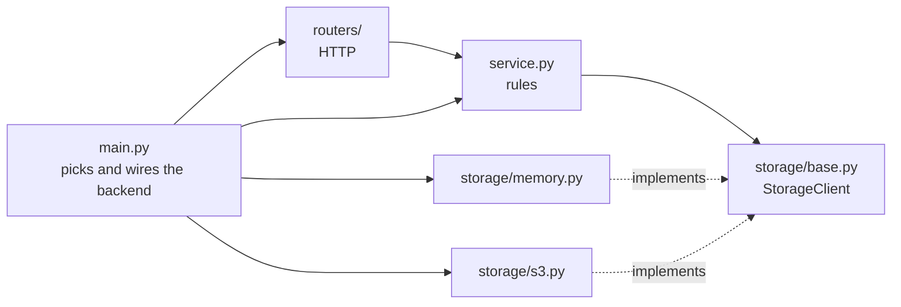

# Architecture

How the service is split into layers, where the provider boundary is, and how the
storage backend is chosen and handed to the code that uses it. Read this before changing
how a request is handled or adding a provider. The code map and the rules contributors
must follow are in [AGENTS.md](../AGENTS.md); the HTTP contract is in [API.md](API.md).

## Layers

| Module | Its job | Knows about |
|---|---|---|
| [routers/](../src/storage_service/routers/) | Parse the request, call one `FileService` method, shape the response, map our errors to statuses | FastAPI, `FileService`, our models and errors |
| [service.py](../src/storage_service/service.py) | The rules: key validation, size limit, create vs replace, content type from the extension | `StorageClient`, our models and errors. No HTTP, no provider. |
| [storage/base.py](../src/storage_service/storage/base.py) | The `StorageClient` interface every backend implements | Our models only |
| [storage/s3.py](../src/storage_service/storage/s3.py) | Talk to any S3-compatible provider and translate its answers and errors | boto3 and botocore |
| [storage/memory.py](../src/storage_service/storage/memory.py) | Keep files in a dict, for tests and trying the API | Our models and errors |
| [main.py](../src/storage_service/main.py) | Build the backend, the service, and the app | Everything above |
| [errors.py](../src/storage_service/errors.py), [models.py](../src/storage_service/models.py) | Our error types and data shapes (plain dataclasses) | Nothing else in the project |

Dependencies point one way: routers, then the service, then the interface, which the
backends implement. Three facts keep the boundary clear:

* Only `routers/` and `main.py` import FastAPI.
* Only `storage/s3.py` imports boto3. No SDK type or exception leaves it.
* Only `main.build_storage` decides which backend is used.

## One request, end to end

`GET /metadata/photos/cat.jpg`, with the S3 backend:

1. **FastAPI** matches the route `/metadata/{key:path}` in
   [routers/metadata.py](../src/storage_service/routers/metadata.py). `:path` lets the
   key contain slashes, so `key` is `photos/cat.jpg`, already percent-decoded.
2. **FastAPI** resolves the `Service` parameter by calling
   [`deps.get_service`](../src/storage_service/routers/deps.py), which returns the
   `FileService` stored on the app, then calls `get_metadata(key, service)`.
3. **Our code**: `FileService.stat` runs `validate_key`. A bad key raises
   `InvalidInput` here, before any provider call. Otherwise it calls `storage.stat(key)`.
4. **Our code**: `S3Storage.stat` calls `head_object(Bucket=..., Key=...)` inside
   `_translate_errors(key)`.
5. **boto3** signs the request, sends it to the configured endpoint with path-style
   addressing (`https://host/bucket/key`), retries with its standard mode (3 attempts
   in total), and gives up after a 5 s connect or 60 s read timeout. These settings are
   in the `S3Storage` constructor.
6. **Our code**: `_info_from_response` picks the five fields we expose from the
   response and strips the quotes S3 puts around the ETag, giving a `FileInfo`.
7. **FastAPI** serializes the returned `FileInfo` dataclass to JSON with status 200.

The failure path for a missing file: `head_object` raises a `ClientError` with code
`"404"`, `_translate_errors` turns it into `FileNotFound`, the error travels up through
the service and route unchanged, and
[`storage_error_handler`](../src/storage_service/routers/error_handlers.py) answers 404
with `{"error": "FileNotFound", "detail": ...}`. A HEAD response has no body, so a
missing bucket also arrives as code `"404"`; see
[FIX-2](../fixesRequired.md#fix-2-a-missing-bucket-is-reported-as-a-missing-file).

## The interface

[storage/base.py](../src/storage_service/storage/base.py) is the source of truth: its
docstrings are the contract each backend follows, and
[tests/test_storage_contract.py](../tests/test_storage_contract.py) checks that contract
against every backend. It has one method for each thing an operation needs from storage,
and nothing else:

| Method | Needed by | Why it exists |
|---|---|---|
| `put` | Create, Replace | Store contents under a key. Create and Replace differ only in a rule the service checks first. |
| `get` | Download | Open a file as its info plus a stream of chunks, so large files never sit in memory. |
| `stat` | Metadata; the existence check before Create, Replace, and Delete | Read a file's info without its contents. "Missing" is `FileNotFound`, so no separate `exists` method is needed. |
| `list_files` | List | One page of files under a prefix, with an opaque cursor. |
| `delete` | Delete | Remove a file. Silent for a missing key, like S3; the service turns that into a 404 by checking with `stat` first. |

Everything provider-specific stays behind it: the endpoint, bucket, and credentials;
path-style addressing; retries and timeouts; multipart uploads; ETag quoting; S3's
continuation tokens; and the provider's error codes, which become `FileNotFound`,
`ProviderError`, or `ProviderUnavailable`. One known exception, an error while a
download is being read, is listed under [Known limits](#known-limits).

## Wiring

The real backend reaches a route in one path, all in
[main.py](../src/storage_service/main.py) and
[routers/deps.py](../src/storage_service/routers/deps.py):

1. `create_app()` is called with no service, as uvicorn does, so it calls
   `build_service(load_settings())`.
2. `build_service` calls `build_storage(settings)`, the only code that picks a backend:
   `InMemoryStorage` for `STORAGE_BACKEND=memory`, otherwise `S3Storage` built from the
   `S3_*` settings.
3. `build_service` wraps that backend in a `FileService`, which only sees it as a
   `StorageClient`.
4. `create_app` stores the service on `app.state.file_service`.
5. On each request, `deps.get_service` returns it, and the `Service` annotation
   (`Annotated[FileService, Depends(get_service)]`) hands it to the route.

Tests supply their own backend at step 4 by passing a ready-made service to
`create_app(service)`, so no application code changes:

* The `client` fixture in [tests/conftest.py](../tests/conftest.py) uses
  `InMemoryStorage`.
* [`FakeStorage`](../tests/fakes.py) records the calls a request makes and can be told
  to fail, for tests of provider failures
  ([tests/test_injection.py](../tests/test_injection.py)).
* `provider_client` calls `create_app()` with no service, so it tests the production
  wiring against a real bucket.

`stubbed_s3` is different: it tests `S3Storage` itself, with botocore's Stubber in
front of its client, not the application.

Replacing S3 with another provider means one new module in `storage/` that implements
`StorageClient` and passes the contract tests, plus one branch in `build_storage`.
`service.py`, `routers/`, and the HTTP contract do not change.

## State and resources

| What | Owner | Lifetime and cleanup |
|---|---|---|
| boto3 client | `S3Storage` | Created once by `build_storage`, lives as long as the app. |
| Upload contents | FastAPI | Starlette spools each upload to a `SpooledTemporaryFile` (in memory up to 1 MiB, then on disk). FastAPI closes it when the request finishes. |
| Download stream | `S3Storage.get` | Opened by `get_object`. `_ChunkReader` closes it when the chunks are exhausted, when reading fails, or when its `close()` is called, even before the first chunk. The download route never calls `close()` (Starlette does not either), so a response that stops early, for example after a client disconnects, leaves it open until garbage collection. |
| `FileService` | The app | Lives as long as the app. Holds only the backend and the size limit; it stores no file data. |
| Files and their info | The provider | The bucket is the only copy. There is no database. |
| `InMemoryStorage` dict | The backend | Lives as long as the app, so everything is lost on restart. Each test gets a fresh one. |
| Provider-test files | `provider_client` and the contract tests | Written under a unique `api-tests/` or `contract-tests/` prefix and deleted afterwards, even when the test fails. |

## Known limits

* Create, Replace, and Delete check existence and then act in two provider calls, so
  two writers racing on one key can both pass the check. See the
  [README](../README.md#known-limitations).
* A provider failure after a download's headers are sent cuts the body off instead of
  returning an error. See the Download gaps in [TESTING.md](../TESTING.md#download).
* When the connection drops while a download is being read, botocore's
  `ResponseStreamingError` escapes `S3Storage` instead of becoming
  `ProviderUnavailable`, against the `get` contract in `storage/base.py`:
  [#26](https://github.com/FaizalJnu/OSPSD-TEAM-6/issues/26).
