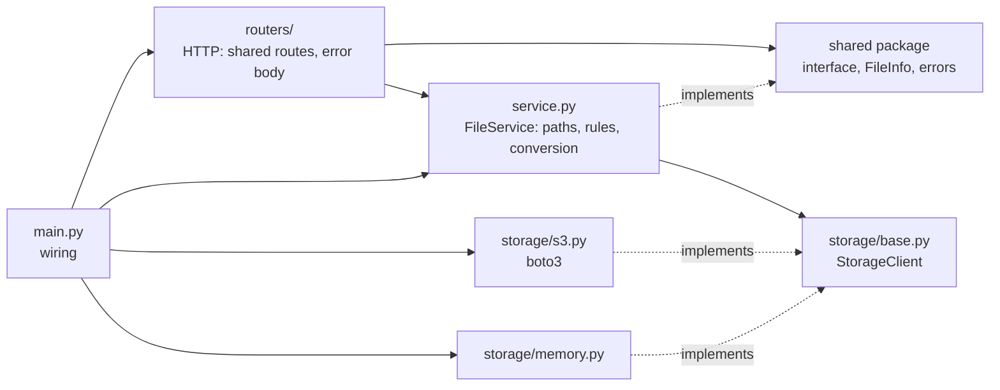

# Design: Team 6's storage service on the shared Document Storage contract

| | |
|---|---|
| **Authors** | Team 6: Faizal Rahman, Debasmith Mandal, Vikram Markali, Darsh Shani, Prateek Saxena |
| **Vertical** | Document Storage (Teams 1, 3 and 6) |
| **Status** | In review |
| **Last updated** | 2026-11-04 |
| **Reviewers** | Team 6: every member reviews the whole document; approvals are recorded in the pull request that adds this file. Contract-facing sections ([API and data model](#4-api-and-data-model), [Open questions](#9-open-questions)): Yashwanth (Team 1) and Jing Qian (Team 3). |
| **Shared contract** | Not tagged yet. This design follows the [decision memo](https://docs.google.com/document/d/1K9U8uO-FVbeu0PGlWpr_frJ6YQmoHXdz/edit) of October 28 and shared issues [#4](https://github.com/Dayana20/ospsd26-cloud-storage/issues/4) and [#5](https://github.com/Dayana20/ospsd26-cloud-storage/issues/5) as of November 4. The shared repository's existing `0.1.0` tag is not a contract revision. |
| **Shared repository** | [Dayana20/ospsd26-cloud-storage](https://github.com/Dayana20/ospsd26-cloud-storage): issues [#2](https://github.com/Dayana20/ospsd26-cloud-storage/issues/2) health, [#3](https://github.com/Dayana20/ospsd26-cloud-storage/issues/3) list, [#4](https://github.com/Dayana20/ospsd26-cloud-storage/issues/4) errors, [#5](https://github.com/Dayana20/ospsd26-cloud-storage/issues/5) move |
| **Baseline** | `dev` at `bb59c59`: release v0.1.0 plus the Level 5 error work |
| **Implementation work** | The pull requests in [Migration plan](#7-migration-and-coordination-plan). Each links its Team 6 issue. |

This document explains how our HW1 service, a FastAPI app over one S3-compatible bucket
verified on OCI Object Storage, will implement the vertical's shared contract, and how we
will show that it does. The agreement itself lives in the memo and the shared issues; this
document links them instead of repeating them, and covers the decisions inside our service.

**In short:** we keep our layers. `FileService` becomes the implementation of the shared
Python interface, the routes move to the shared `?path=` routes and error body, and
`StorageClient` gains four methods (copy, one-level list, batch delete, bucket check) so
that Move, folder Delete, the full List and the provider health check can be built on S3.
The release that ships this is a breaking change, v0.2.0, with a migration table in
[docs/API.md](docs/API.md).

## 1. Context

A consumer, for example a Calendar service that stores attachments, should be able to
switch between the three storage services by changing the base URL and credentials. Today
it cannot. To store `docs/report.pdf` it sends `POST /files` with form fields `file` and
`path` to Team 1, but `POST /files/docs/report.pdf` to us. When the file already exists,
both answer 409, but Team 1 sends `{"error": {"code": "conflict", ...}}` and we send
`{"error": "FileAlreadyExists", "detail": ...}`, so the consumer's error handling breaks
on one of them.

Some differences produce no error at all, which is worse. Our List treats `prefix` as
plain text at every depth, so listing `docs` also returns `docs2/a.txt` and
`docs/sub/b.txt`. Team 3's list returns one folder level. A consumer that counts the files
in a folder gets a different answer from each service and is told nothing. Our metadata
returns `key` and `last_modified` where the others return `path` and `modified_at`, so a
consumer that reads `path` from our response gets nothing.

The memo records how the vertical resolved these differences. This document records what
our service must change to follow it.

## 2. Goals and non-goals

**Goals.** Each one can be checked:

* A consumer runs the shared workflow against our service with the same requests and
  the same handling of results and errors as against Teams 1 and 3. The workflow:
  create a file, read its metadata, download it and compare the bytes, list its folder,
  move it, read its metadata at the new path, delete it, and confirm that metadata now
  returns 404.
* Every error response uses the shared body and the shared status and code table.
* Our service passes the shared conformance suite: on the in-memory backend in CI, and
  against OCI before each release.
* No HW1 feature disappears silently. Each one maps to a common operation, stays as a
  documented extension, or is removed for a reason recorded in
  [sections 4.6](#46-what-our-translation-loses-or-narrows) and [4.7](#47-hw1-to-the-common-api).
* HW1's rules still hold: boto3 stays in `storage/s3.py`, the fast tests need no network
  or credentials, and every new provider behavior is checked against a real bucket.

**Non-goals.**

* Moving stored data between providers. A path refers to a file in one service's
  storage.
* Naming a bucket in requests. One deployment serves one bucket, as now.
* Hiding differences S3 cannot remove: letter case, folders that exist only while
  they contain something, and the absence of atomic Move and folder Delete. The contract
  states them; we report them precisely ([section 4.6](#46-what-our-translation-loses-or-narrows)).
* Folder Move. It stays a documented extension of Team 3's service (#5).
* Deployment. Milestone 3 is still WIP; the assumptions it depends on are in
  [section 6.6](#66-assumptions-for-deployment-wip).

## 3. Architecture and request flow

### 3.1 Components

The dependency direction does not change: routes call the service, the service calls
`StorageClient`, and the backends implement it. What changes is that the routes see the
service only through the shared interface, and that the shared package supplies the
models and errors the routes return.



| Module | What changes |
|---|---|
| [routers/](src/storage_service/routers/) | Every operation moves to the shared routes, with the path in `?path=`. New `move.py` and `health.py`. `listing.py` serves the one-level list. Team 6 extensions move under `/ext/`. |
| [routers/error_handlers.py](src/storage_service/routers/error_handlers.py) | The body becomes `{"error": {"code", "message"}}`. The status table becomes a status and code table. The failure log records Move and folder Delete outcomes, including `partial`. |
| [service.py](src/storage_service/service.py) | Path normalization, conversion from the storage layer's records to the shared `FileInfo`, and the new operations: Move, folder Delete, the full List loop, provider health. |
| [errors.py](src/storage_service/errors.py) | Our error types subclass the shared package's errors and keep `storage_call` and `provider_code` for the log. New `InvalidOperation` (422). |
| [models.py](src/storage_service/models.py) | Today's `FileInfo` becomes `ObjectInfo`, a record internal to the storage layer. The routes return the shared `FileInfo`. |
| [storage/base.py](src/storage_service/storage/base.py) | Four new methods: `copy`, `list_children`, `delete_many`, `check`. See [section 3.3](#33-new-storageclient-methods). |
| [storage/s3.py](src/storage_service/storage/s3.py) | `CopyObject`, `ListObjectsV2` with `Delimiter="/"`, `DeleteObjects`, `HeadBucket`. Errors are translated as today. |
| [storage/memory.py](src/storage_service/storage/memory.py) | The same four methods. It keeps copying S3's behavior, including folders that exist only while they hold a file. |
| [main.py](src/storage_service/main.py) | Registers the new routers. Choosing the backend does not change. |

Ownership of state does not change. `build_storage` creates the boto3 client once; it
lives as long as the app. `_ChunkReader` still closes each download stream. No new
long-lived state is added: Move and folder Delete hold only the keys of the batch in
progress, and List holds the folder's entries until the response is sent
([section 6.4](#64-provider-calls-and-local-work)).

### 3.2 One request, end to end

`PATCH /files?path=/docs/report.pdf` with body `{"new_path": "/archive/report.pdf"}`,
S3 backend. This is the most complex new operation; the others follow the same path.

1. **FastAPI** matches `PATCH /files` in `routers/move.py` and parses the query parameter
   `path` and the JSON body (`new_path`). A missing field or invalid JSON raises
   `RequestValidationError`, which `validation_error_handler` turns into 400
   `invalid_request`. Nothing has reached the service.
2. **FastAPI** resolves the `Service` dependency: `deps.get_service` returns the object
   stored on `app.state`, typed as the shared interface.
3. **`FileService.move`** normalizes both paths to their canonical form
   (`/docs/report.pdf`, `/archive/report.pdf`) and maps each to a key by dropping the
   leading `/`. The same canonical path, or paths that differ only in letter case, raise
   `InvalidOperation` (422). Validation happens here, before any provider call.
4. **`FileService.move`** checks the source: `storage.stat("docs/report.pdf")`. A miss
   is followed by `list_children("docs/report.pdf/")`, one call with `MaxKeys=1`: if the
   source is a folder the service raises `InvalidOperation` (Move is files only),
   otherwise `FileNotFound` (404).
5. **`FileService.move`** checks the destination: `stat("archive/report.pdf")` must miss,
   and so must `list_children("archive/report.pdf/")`. Either one finding something raises
   `Conflict` (409). Nothing has been written.
6. **`S3Storage.copy`** calls `CopyObject`. The stored content type is copied with the
   object.
7. **`S3Storage.delete`** calls `DeleteObject` on the source.
8. **`FileService.move`** converts the copy's `ObjectInfo` to the shared `FileInfo`
   (`id` null, `name` `report.pdf`, `path` `/archive/report.pdf`, `size`, `modified_at`,
   `etag`). **FastAPI** serializes it with status 200.

**An expected failure: the destination is taken.** In step 5, `stat` finds the object and
the service raises `Conflict(storage_call="stat")`. The error passes up through the route
unchanged. `storage_error_handler` looks up `Conflict` and answers 409
`{"error": {"code": "conflict", "message": "something already exists at /archive/report.pdf"}}`,
then writes one log line with `"operation": "move_file"`, `"storage_call": "stat"` and
`"write_outcome": "not_attempted"`, because no write was attempted.

**A failure that leaves a partial result.** If step 6 succeeds and step 7 fails or times
out, the original may or may not have been deleted. The service raises `ProviderError`
marked partial. The caller gets 502 `provider_error`, with a message saying the move
could not be confirmed, and the log records `"write_outcome": "partial"`,
`"storage_call": "delete"` and the provider's code. The caller checks metadata at both
paths before retrying (#5).

Where each job happens:

* **Validation:** paths and sizes in `FileService`; request shape in FastAPI, reported as
  400 by our handler.
* **Domain conversion:** in `FileService`, from `ObjectInfo` to the shared `FileInfo`.
* **Error translation:** provider errors to our errors in `storage/s3.py`; our errors to
  statuses and codes in `routers/error_handlers.py` only.
* **Logging:** one JSON line per failed request, written in `routers/error_handlers.py`,
  as in [docs/API.md › Failure logs](docs/API.md#failure-logs).

### 3.3 New StorageClient methods

Each method makes one kind of provider call, as today, so tests over `FakeStorage` can
still count the calls a request makes. Loops over pages belong to the service.

| Method | S3 call | Used by |
|---|---|---|
| `copy(source, destination) -> ObjectInfo` | `CopyObject` | Move |
| `list_children(prefix, limit, cursor) -> ChildrenPage` | `ListObjectsV2` with `Delimiter="/"`: files from `Contents`, folders from `CommonPrefixes` | List, and the folder checks in Create and Move |
| `delete_many(keys) -> list[str]` | `DeleteObjects`, up to 1000 keys per call per AWS docs. Returns the keys that failed. | folder Delete |
| `check() -> None` | `HeadBucket` | provider health |

`list_files` (every depth, paged) stays: folder Delete uses it to find every key under a
folder, and the `/ext/list` extension serves it. Page and batch sizes are constructor
arguments of `S3Storage` that default to 1000, so the provider tests can force several
pages with three files instead of writing 1001.

## 4. API and data model

### 4.1 The contracts we implement

The authoritative contract will be the tagged shared package and HTTP contract in the
shared repository. Until it is tagged, these are the sources, with each clause's status
as of November 4:

| Clause | Source | Status |
|---|---|---|
| Operations, file info fields, error body, recursive delete, full list, two health checks | Memo | Agreed at the joint meeting |
| Error statuses and codes, 409 vs 422, missing bucket is 502, uncertain writes | [#4](https://github.com/Dayana20/ospsd26-cloud-storage/issues/4) (Darsh) | Agreed by Teams 1 and 6. No response from Team 3. |
| Move route and errors; `id` may be null on S3 | [#5](https://github.com/Dayana20/ospsd26-cloud-storage/issues/5) (Vikram) | Agreed by Teams 1 and 6. No response from Team 3. |
| Health routes | Memo, [#2](https://github.com/Dayana20/ospsd26-cloud-storage/issues/2) | Routes agreed; the failure codes are open (Q6) |
| List | Memo, [#3](https://github.com/Dayana20/ospsd26-cloud-storage/issues/3) | Agreed; folder fields and size limit open (Q3, Q4, Q7) |
| Download route `GET /files/download?path=` | Memo (Debasmith) | Proposed by Team 6 |
| Path rule | Memo (Team 1, Laya) | Agreed in outline; maximum length open (Q9) |

### 4.2 Paths

The API accepts a path with or without a leading `/` and works with its canonical form,
which always starts with `/`. Responses always use the canonical form. Our S3 key is the
canonical path without its leading `/`, so `/docs/report.pdf` is stored as
`docs/report.pdf`. **Files already in the bucket keep their keys:** HW1's key
`docs/report.pdf` is now path `/docs/report.pdf`, and nothing needs rewriting.

We keep HW1's key rules and apply them after removing the leading `/`: no empty path, no
empty segment (so no `//` and no trailing `/`), no `.` or `..` segment, no control
characters, at most 1024 UTF-8 bytes. A path that breaks one is 400 `invalid_request`
before any provider call. If Team 1's path rule (Q1 in the memo) decides to strip a
trailing `/` instead of rejecting it, the change is confined to `normalize_path` and its
tests. The folder `/` is valid only for List.

### 4.3 File info

| Field | Type | Our value | HW1 field |
|---|---|---|---|
| `id` | string or null | Always `null`: S3 has no identifier that survives a move (#5, [section 5.3](#53-id-on-s3-null-or-our-own-identifier)) | — |
| `name` | string | Last segment of the path | — |
| `path` | string | Canonical path | `key` |
| `size` | integer | Bytes | `size` |
| `modified_at` | string | ISO 8601 in UTC ending in `Z`, as today | `last_modified` |
| `etag` | string or null | Kept as the memo's optional field, without quotes | `etag` |

List entries add `type`, `"file"` or `"folder"`. A folder has `size`, `modified_at` and
`etag` null: S3 stores nothing for a folder, and per Dropbox's API docs (unverified by
us) its folder metadata has no size or modification time either. We propose this on #3
(Q3).

`etag` stays because the memo kept it as an optional field, and because Team 6 measured
why it matters: on OCI, `last_modified` has one-second precision, so a Create and a
Replace in the same second reported the same time ([TESTING.md › Create and Replace › Provider observations](TESTING.md#provider-observations)).
Without `etag`, a consumer could not tell those two versions apart.

### 4.4 Operations

| Operation | Route | Success | Notes for our service |
|---|---|---|---|
| Create | `POST /files`, multipart `file` and `path` | 201, file info | 409 if a file or a folder exists at `path` |
| Replace | `PUT /files`, multipart `file` and `path` | 200, file info | 404 if no file exists; never creates |
| Download | `GET /files/download?path=` | 200, the exact bytes | Streams as today; headers unchanged (`Content-Type`, `Content-Length`, `ETag`, `Content-Disposition`) |
| Metadata | `GET /files/metadata?path=` | 200, file info | |
| Move | `PATCH /files?path=`, body `{"new_path"}` | 200, file info at the new path | Files only; copy, then delete ([section 3.2](#32-one-request-end-to-end)) |
| Delete | `DELETE /files?path=` | 204 | A folder and everything under it; `/` is refused (Q5) |
| List | `GET /files?path=` | 200, the folder's direct children | One level; every provider page fetched; sorted by path; 404 if the folder does not exist |
| Health | `GET /health` | 200 `{"status": "ok"}` | Makes no provider call |
| Provider health | `GET /health/provider` | 200 `{"status": "ok"}` | One `HeadBucket`; 503 if it fails |

None of the new routes has a path parameter, so no route can capture another. HW1's
`GET /files/{key:path}`, if it were kept, would capture `/files/download` and
`/files/metadata`.

### 4.5 Representative request

*Illustrative expected response: Move is not implemented yet. The observed response and
how it was produced will replace this once the OCI run is recorded in TESTING.md.*

```bash
curl -s -X PATCH "$B/files?path=/docs/report.pdf" \
  -H "Content-Type: application/json" \
  -d '{"new_path": "/archive/report.pdf"}'
```

```json
{
  "id": null,
  "name": "report.pdf",
  "path": "/archive/report.pdf",
  "size": 48213,
  "modified_at": "2026-11-04T15:02:11Z",
  "etag": "9b2cf535f27731c974343645a3985328"
}
```

The same request when `/archive/report.pdf` already exists:

```json
{"error": {"code": "conflict", "message": "something already exists at /archive/report.pdf"}}
```

### 4.6 What our translation loses or narrows

* **`id` is always null.** Consumers identify files by path on every service and must not
  expect `id` to survive a move (#5).
* **`content_type` leaves the file info.** It is still stored with each object and still
  sent as the `Content-Type` header of Download. Listings never had it (S3's list call
  does not return it, so HW1 always sent `null` there), and it is not a shared field.
* **A move changes `modified_at`.** `CopyObject` writes a new object, so `modified_at` is
  the time of the move. Per AWS docs a copied object can also get a new `etag`, for
  example when the original was uploaded in parts. Neither is verified on OCI yet; the
  Move run will record both. Whether Dropbox keeps the time on a move is for Teams 1 and
  3 to say.
* **A folder on S3 exists only while it contains a file.** S3 has keys, not folders.
  After the last file under `/docs` is deleted, List of `/docs` returns 404 on our
  service, while on Dropbox the empty folder stays and List returns 200 with no entries.
  We will not write placeholder objects to imitate folders: every Create and Delete would
  have to maintain them, and objects written by other tools would not have them. We
  propose that the contract state this difference (Q4).
* **A file and a folder can share a path on S3** (`docs` and `docs/a.txt`), but not on
  Dropbox. We refuse to create or move a file onto a path that is a folder (one extra
  list call). We do not check whether a parent of the new path is a file, because that
  costs one `HEAD` for every parent segment.
* **Letter case.** `/A.pdf` and `/a.pdf` are two files on S3 and one on Dropbox. We do not
  try to prevent this on Create, which would need a list call of the folder for every
  upload. Move refuses case-only renames with 422 (#5).

### 4.7 HW1 to the common API

| HW1 | Common API | What happens |
|---|---|---|
| `POST /files/{key}` | `POST /files` | Key moves into the `path` form field |
| `PUT /files/{key}` | `PUT /files` | Same |
| `GET /files/{key}` | `GET /files/download?path=` | Same bytes and headers |
| `GET /metadata/{key}` | `GET /files/metadata?path=` | New file info fields |
| `DELETE /files/{key}` | `DELETE /files?path=` | Also deletes folders |
| `GET /files?prefix=&limit=&cursor=` | `GET /files?path=` | One folder level, complete, with folders |
| HW1 paged list | `GET /ext/list?prefix=&limit=&cursor=` | **Team 6 extension.** Same paging, prefix matching at every depth, and cursors as HW1, returning the new file info fields. It does not replace the common List. |
| — | `PATCH /files?path=` | New: Move |
| — | `GET /health`, `GET /health/provider` | New |
| Error body `{"error", "detail"}` | `{"error": {"code", "message"}}` | Every error |

The paged list stays because it is the only way to read a very large folder in bounded
pieces until Q7 is decided. If the group adds an optional cursor to the common List, we
will deprecate the extension.

## 5. Alternatives and tradeoffs

### 5.1 Where the shared interface sits

**Chosen:** `FileService` implements the shared interface, and `StorageClient` stays as
our internal backend interface.

**Alternative:** `S3Storage` implements the shared interface directly, and `FileService`
and `StorageClient` are removed.

The shared interface works at the level of operations: a folder Delete, a complete List,
a Move. Implemented directly by the backend, each backend would repeat the rules: path
validation, the create-or-replace checks, the paging loop, batched deletes, and the
judgment of whether a failure left a partial result. `InMemoryStorage` would have to
repeat them too, and the in-memory tests would stop telling us anything about S3, because
they would test a second copy of the rules. With two layers, the rules exist once in
`FileService` and both backends stay simple stores. `FakeStorage`'s tests, which count
storage calls and inject failures between them, keep working.

The cost is one conversion, from `ObjectInfo` to the shared `FileInfo`, in
`FileService`. **We would revisit this** if the shared package defines a backend-level
interface that the conformance suite tests directly. In that case `StorageClient` could
become that interface.

### 5.2 Replace the HW1 routes, or keep them for compatibility

**Chosen:** replace them, with a migration table in docs/API.md and a breaking-change
release (v0.2.0, following [CONTRIBUTING.md › Versioning](CONTRIBUTING.md#versioning)).

**Alternative:** keep the HW1 routes next to the new ones.

The two sets collide. `GET /files` cannot serve both HW1's paged list (`prefix`, `limit`,
`cursor`) and the common List (`path`) without choosing a meaning from the query
parameters, which is fragile and hard to document. HW1's `GET /files/{key:path}` would
catch `/files/download` unless it is registered after it, and a file actually named
`download` would then be unreachable through the old route. A compatibility route would
also have to keep the old error body, so the same service would answer errors in two
shapes. We know of no consumer of the HW1 routes outside our own tests and the course
staff, so a documented migration costs less than maintaining both sets. **We would
revisit this** if a team reports that it calls the HW1 routes. We would then serve them
under a `/v0` prefix rather than at their old paths.

### 5.3 `id` on S3: null, or our own identifier

**Chosen:** `null` (#5).

**Alternative:** generate a UUID on Create and store it in the object's user metadata
(`x-amz-meta-id`). Per AWS docs, `CopyObject` copies user metadata by default, so the id
would survive our Move, and Replace could carry it over from the existence check it
already makes.

This alternative fails on List: per AWS docs, `ListObjectsV2` does not return user
metadata, so filling `id` for a folder of N files would take N extra `HEAD` calls on
every List. Objects written by other tools, or before this release, would have no id, so
consumers would have to handle `null` anyway. The memo also defines `id` as the
provider's identifier, which a value only our service maintains is not. **We would
revisit this** if a consumer needs a reference that survives a move, and the group would
then have to decide what List returns.

### 5.4 Folder Delete: batched or one call per file

**Chosen:** `DeleteObjects`, 1000 keys per call per AWS docs, falling back to one
`DeleteObject` per key only if OCI rejects batch deletes.

A folder of N files costs about 2 × N/1000 calls with batches, against N + N/1000 one
key at a time. Whether OCI accepts `DeleteObjects` from our client is **unverified**.
`DeleteObjects` is one of the calls for which boto3 must send a checksum, and boto3's
change of checksum defaults in 1.36 is what broke our OCI uploads in HW1 (FIX-1). The
first folder Delete run on OCI settles this before the pull request merges.

## 6. Failure behavior and operational concerns

### 6.1 From provider outcome to HTTP response

| Provider outcome | Our error | Status and code |
|---|---|---|
| Bad path, missing field, invalid JSON or multipart | `InvalidInput` | 400 `invalid_request` |
| Credentials or permissions refused | `AccessDenied` | 403 `permission_denied` |
| No file or folder at the path (bucket confirmed) | `FileNotFound` | 404 `not_found` |
| Destination taken on Create or Move | `Conflict` (was `FileAlreadyExists`) | 409 `conflict` |
| Upload above `MAX_UPLOAD_BYTES` | `FileTooLarge` | 413 `file_too_large` |
| Forbidden operation: same-path or case-only Move, folder as Move source, Delete of `/` | `InvalidOperation` (new) | 422 `invalid_operation` |
| Missing bucket, other rejection, known partial Move or folder Delete | `ProviderError` | 502 `provider_error` |
| Provider unreachable or timed out | `ProviderUnavailable` | 503 `provider_unavailable` |
| No route / wrong method / bug | — | 404 `route_not_found` / 405 `method_not_allowed` / 500 `internal_error` |

A missing bucket stays 502, never 404, as FIX-2 established on OCI (#4). Two codes from
#4 never occur in our service: `provider_not_configured`, because the service refuses to
start without its `S3_*` settings, and `service_busy`, because we have no concurrency
limit. Whether provider throttling and transient 5xx become 503 instead of 502 is open in
#4 and tracked for us in [#73](https://github.com/FaizalJnu/OSPSD-TEAM-6/issues/73).

### 6.2 Writes whose outcome is uncertain

A 502 or 503 after a write does not prove that nothing changed, as
[docs/API.md › After a failed write](docs/API.md#after-a-failed-write) already says for
Create, Replace and Delete. The redesign adds two operations made of several writes:

* **Move:** if the copy fails, the destination may exist. If the delete fails after the
  copy, the source may or may not still exist. Both are 502 or 503, and the caller checks
  both paths.
* **Folder Delete:** each batch either completes, reports failed keys, or fails outright.
  Any failure stops the operation with 502 or 503. The caller lists the folder before
  retrying. Retrying is safe: it deletes whatever is left.

The failure log's `write_outcome` gains a third value. `not_attempted` and `unknown` keep
their meanings, and `partial` means at least one write succeeded before the failure. A
partial folder Delete also logs how many keys were deleted and how many failed.

### 6.3 Retries

The service adds no retries. boto3's standard mode, already configured, retries each
call up to three times in total. Each of our calls is safe to repeat on its own: a
repeated `CopyObject` writes the same object again, and a repeated `DeleteObject` or
`DeleteObjects` succeeds for keys already gone. The service does not retry a whole Move,
because after a partial Move a retry would find the source missing and answer 404, which
hides what happened. Reads (Download, Metadata, List, health) are safe for the caller to
retry.

### 6.4 Provider calls and local work

Calls on success with the S3 backend. Per AWS docs, `ListObjectsV2` returns at most 1000
entries per call and `DeleteObjects` accepts at most 1000 keys. A `stat` that misses
costs two calls, because it confirms the bucket with `HeadBucket` (FIX-2).

| Operation | Calls | HW1 |
|---|---|---|
| Create | `HEAD` miss + `HeadBucket` + folder check (`LIST`, 1 key) + upload + `HEAD` = 5 (an upload above 8 MB is a multipart upload) | 4 |
| Replace | `HEAD` + upload + `HEAD` = 3 | 3 |
| Download, Metadata | 1 | 1 |
| Move | `HEAD` + `HEAD` miss + `HeadBucket` + folder check + `CopyObject` + `DeleteObject` = 6 | — |
| Delete, file | `HEAD` + `DeleteObject` = 2 | 2 |
| Delete, folder of N files | `HEAD` miss + `HeadBucket` + about N/1000 × (`LIST` + `DeleteObjects`) | — |
| List, N entries | about N/1000 `LIST` | 1 per page |
| Provider health | `HeadBucket` = 1 | — |

List's local work grows with the folder: it holds all N entries in memory and sorts them,
O(N log N), before responding. A folder of 10,000 direct children takes at least 10 calls
and one response holding 10,000 entries. That is why Q7 (a cap or an optional cursor)
matters. Until it is decided we implement the complete List as agreed, and the paged
extension remains available for large folders.

### 6.5 Configuration, credentials, limits and cleanup

* **No new settings.** If Q8 adopts 150 MiB as the shared upload limit, the default of
  `MAX_UPLOAD_BYTES` changes from 1 GiB, and `.env.example` and the README change with it.
* **Permissions.** Move needs read on the source and write on the destination; folder
  Delete needs delete; provider health needs the bucket read that FIX-2 already requires.
  The existing least-privilege policies in [docs/PROVIDERS.md](docs/PROVIDERS.md) cover
  these. The first OCI runs confirm it.
* **Sensitive data.** Unchanged: responses and logs never contain the provider's message
  or the bucket name, and secrets stay out of `repr` and logs. Logs contain paths, as
  HW1's logs contain keys.
* **Limits.** Uploads still spool to a temporary file before the size check
  ([README › Known limitations](README.md#known-limitations)). Per AWS docs, `CopyObject`
  copies up to 5 GB in one call, above our upload limit, so Move of a file uploaded
  through us is one copy. A file larger than 5 GB written by another tool fails with 502.
* **Cleanup.** Provider tests keep writing under unique `contract-tests/` and `api-tests/`
  prefixes and deleting them afterwards, following every page
  ([tests/test_cleanup.py](tests/test_cleanup.py)).

### 6.6 Assumptions for deployment (WIP)

Milestone 3 is not final. The design assumes, and the deployment work may rely on, the
following:

* `GET /health` checks only the process, so it is safe as a liveness check. A provider
  outage must not make the platform restart the service in a loop.
* `GET /health/provider` checks the bucket and suits readiness or alerting.
* All configuration comes from environment variables, and the process keeps no state
  between requests.

## 7. Migration and coordination plan

### 7.1 Adopting the shared package

We will depend on the shared package as a uv git dependency pinned to a tag, so
`uv.lock` records the exact revision. We will never depend on a branch. The memo fixes
Python 3.12 for the package; we run 3.13, which is compatible as long as the package
declares `>=3.12` rather than `==3.12.*`. We will check this when the first tag exists.

Until the tag exists, pull requests 1 to 7 below follow the memo and issues #4 and #5,
with our own models and errors shaped to match them. Pull request 8 then swaps in the
package. The risk is that the package's names or shapes differ from what we built.
Darsh (errors) and Prateek (conformance suite) work in the shared repository, so they
will see such a difference early.

### 7.2 Existing callers

The release is v0.2.0, a breaking change. Its release notes link the migration table in
[section 4.7](#47-hw1-to-the-common-api), which also goes into docs/API.md. Stored files
need no migration ([section 4.2](#42-paths)).

### 7.3 Changes

Owners follow HW1's operation ownership in docs/API.md and the memo's roles; confirm
them in review.

| # | Change | Owner | Depends on | Verified by |
|---|---|---|---|---|
| 1 | Error body and status and code table | Darsh | #4 (Team 3 pending) | `test_failures.py`, `test_invalid_input.py`, `/openapi.json` schema |
| 2 | Paths and file info: `normalize_path`, `ObjectInfo`, conversion to the new fields | Darsh | Memo path rule | `test_service.py` |
| 3 | Shared routes for Create, Replace, Download, Metadata and file Delete | Debasmith, with Vikram for Download | 2 | Per-operation test files, in memory and `stubbed_s3` |
| 4 | Health and provider health | Debasmith | #2 (Q6) | Tests with a failing `check`; provider run with a wrong bucket |
| 5 | List: one level, complete, folders; paged extension at `/ext/list` | Prateek | 2; #3 (Q3, Q4) | `test_list.py`; provider run forcing several pages |
| 6 | Move | Vikram | 1, 2; #5 | `test_move.py`; partial-move tests over `FakeStorage`; Move run on OCI recorded in TESTING.md |
| 7 | Folder Delete | Faizal | 1, 5 | `test_delete.py`; partial-delete tests; folder Delete run on OCI (settles `DeleteObjects`) |
| 8 | Adopt the shared package: routes typed against its interface, its models and errors | Darsh | First contract tag | Full fast suite unchanged in behavior |
| 9 | Run the shared conformance suite against our service | Prateek | 8; suite in the shared repository | Suite passes in memory in CI and on OCI |
| 10 | Docs (API.md, ARCHITECTURE.md, TESTING.md, PROVIDERS.md, README) and release v0.2.0 | Faizal (release manager) | 1–9 | Release checklist in CONTRIBUTING.md |

### 7.4 An early end-to-end check

As soon as pull requests 1 to 3 merge, we run the first half of the consumer workflow
(create, metadata, download and compare, delete, metadata 404) against our service on
OCI, then against Team 1's service, changing only the base URL. This is the earliest
point at which a wrong assumption about paths, the form fields or the error body would
show up, and it does not wait for the tag or for Move.

### 7.5 An incompatible change after implementation starts

The memo's rule applies: a breaking change to the shared contract needs a new tag and
sign-off from all three implementation contacts. On our side, Debasmith (implementation
contact) reviews the change against this document and lists what it breaks. The upgrade
is one pull request that moves the pin and fixes the code and tests together, so no
commit on `dev` is half-migrated. If our service's own API changes as a result, we bump
the version, label the pull request `breaking change`, and announce it in the Document
Storage Slack channel, where the memo asks consumer teams to raise concerns.

## 8. Verification plan

### 8.1 Guarantees and how each is checked

Controlled tests (`client` on the in-memory backend, and `fake_client` over
`FakeStorage`) run in CI without network. `stubbed_s3` checks the translation of S3's
answers with botocore's Stubber, also without network. Provider tests
(`@pytest.mark.provider`) check what only a real bucket can show.

| Guarantee | Controlled | `stubbed_s3` | Real provider (OCI) |
|---|---|---|---|
| Every error uses the shared body and code | Every status, including route, method and bug errors | — | One 404 and one 403 run |
| Paths normalize the same way everywhere | `test_service.py`, with and without a leading `/` | — | — |
| A missing bucket is 502, never 404 | Existing FIX-2 tests, moved to the new routes | `HeadBucket` translation | Wrong-bucket run |
| Move never overwrites, and reports a partial move as 502 | Destination taken; delete failing after copy (`FakeStorage` fails after the change) | `CopyObject` and its errors | Move run: bytes, `modified_at`, `etag` after the move |
| List is complete, one level and sorted, with folders | Paging with page size 2; files and folders mixed; empty result | `CommonPrefixes` translation | Three files at page size 2; a nested folder |
| Folder Delete removes everything or reports 502 | A batch reporting failed keys; failure between batches | `DeleteObjects` partial response | Folder of several files in batches of 2 |
| Provider health tells the provider from the API | `check` raising each provider error | `HeadBucket` | Correct and wrong bucket |
| Shared contract behavior | Conformance suite, in memory, in CI | — | Conformance suite before release |

### 8.2 Conformance and the consumer workflow

The shared suite lives in the shared repository (Prateek). Team 6 proposes that it take a
base URL, so that the same tests run against any service over HTTP and end with the
consumer workflow from [section 2](#2-goals-and-non-goals). In our repository, a fixture
runs it against `create_app` on the in-memory backend in the fast suite, and against the
production wiring on OCI under `-m provider`. Our existing
[tests/test_storage_contract.py](tests/test_storage_contract.py) stays: it checks our
internal `StorageClient` across our backends, which the shared suite does not see.

A mismatch shows up as a failing shared test against one service and not the others. For
differences the contract accepts (empty folders, letter case), the suite needs a
provider-specific expectation rather than a skipped test, so a real difference is never
hidden. Prateek raises this with the other teams.

### 8.3 Concerns raised, and how each was handled

| Concern | Raised by | Outcome |
|---|---|---|
| "Both copies exist" after a failed delete overstates what is known; the original's deletion is unconfirmed | Darsh, on #5 | **Resolved:** #5 and this document say "unconfirmed" |
| Two versions written in the same second on OCI cannot be told apart by `modified_at` | Team 6 provider runs | **Resolved:** `etag` kept as an optional field (memo) |
| A missing bucket reported as "file not found" leads consumers to re-create files into nothing | Team 6, FIX-2 | **Agreed** by Teams 1 and 6 in #4; Team 3 pending |
| A provider outage should not restart the service | Handout, Milestone 3 draft | **Resolved:** `/health` makes no provider call |
| Team 3 has not answered #4 or #5 | Team 6 | **Deferred.** Owner: Debasmith, with the coordinator. Condition: before the first contract tag. If Team 3 objects, pull requests 1 and 6 change in one table each. |
| Team 3's [PR #37](https://github.com/Shreyas191/OSPSD-Team-3/pull/37) makes PUT create a missing file, against the memo's 404 | Darsh, on #4 | **Open.** Owner: Team 1's create and replace clause (Annie, Shini). It affects the conformance suite, not our code. |

### 8.4 Known gaps

* `DeleteObjects` on OCI and the behavior of `etag` and `modified_at` after `CopyObject`
  are unverified until the provider runs of pull requests 6 and 7.
* The race between the existence check and the write in Create, Replace, Move and Delete
  remains ([README › Known limitations](README.md#known-limitations)). Per AWS docs, S3
  now supports conditional writes (`If-None-Match`, `If-Match`), which would close it for
  Create and Replace. OCI support is unverified. We will investigate after v0.2.0 rather
  than add an untested dependency on it now.
* Concurrent writes during a List or folder Delete may or may not be seen. Neither
  operation is a snapshot.

## 9. Open questions

Questions 1 to 9 affect the shared contract and must close before we treat it as
accepted. Question 10 is ours.

| # | Question | Consequence | Owner | Next step |
|---|---|---|---|---|
| 1 | First contract tag, and who maintains the package | Pull request 8 cannot start; consumers cannot pin a version | Coordinator (Dayana) | Agree with the implementation contacts |
| 2 | Team 3's agreement to #4 and #5 | If Team 3 objects to 409/422 or a null `id`, our error table and Move change | Debasmith, with the coordinator | Ask Jing Qian for a yes or a concrete objection by a named date |
| 3 | What `size`, `modified_at` and `etag` are for folder entries | Consumers cannot read folder entries the same way on every service | Yashwanth (#3) | Team 6 proposes null on #3 |
| 4 | An empty folder on S3 | List returns 404 on our service where Dropbox returns 200 | Yashwanth (#3) | Team 6 proposes the contract state the difference |
| 5 | A path of the wrong kind (Download or Metadata of a folder, List of a file) and Delete of `/` | Different statuses per service, and Delete of `/` would empty the bucket | Darsh (#4) | Team 6 proposes 422 `invalid_operation` for each |
| 6 | Provider health failure codes | Monitoring cannot tell an outage from a misconfiguration | Dayana (#2) | Team 6 proposes 503 always, with the code saying why (`provider_unavailable`, `permission_denied` or `provider_error`) |
| 7 | A cap or optional cursor for List (memo Q5) | Unbounded calls and response size for large folders | Yashwanth | Decide on #3 |
| 8 | Shared upload limit and its status (memo Q9) | A file accepted by one service is refused by another | Teams 1 and 3 | Confirm MiB or MB |
| 9 | Shared maximum path length | A path accepted by one service is refused by another | Teams 1 and 3 | Confirm their limits; ours is 1024 bytes |
| 10 | `DeleteObjects` on OCI | Folder Delete costs about N calls instead of about 2N/1000 | Faizal | Answered by the pull request 7 provider run |

## 10. Actions

Target dates are proposals for the team to confirm.

| Action | Owner | Output | Depends on | Checkpoint |
|---|---|---|---|---|
| Approve this document | All of Team 6 | Approvals on the pull request | — | Nov 4 |
| Share the contract-facing sections | Debasmith | Comments from Teams 1 and 3, answered | This pull request | Nov 6 |
| Post Team 6's proposals for Q3 to Q6 | Prateek (#3), Darsh (#4), Debasmith (#2) | Comments on the shared issues | — | Nov 6 |
| Open one Team 6 issue per change in [section 7.3](#73-changes) | Debasmith | Linked issues | This document accepted | Nov 6 |
| Changes 1 to 4, then the early end-to-end check | Darsh, Debasmith, Vikram | Merged pull requests; check recorded in TESTING.md | #4 | Nov 11 |
| Changes 5 to 7, with OCI runs | Prateek, Vikram, Faizal | Merged pull requests; runs recorded in TESTING.md | 1–2; #3, #5 | Nov 18 |
| Changes 8 and 9 | Darsh, Prateek | Pull requests; conformance results | Contract tag | One week after the tag |
| Release v0.2.0 and the joint consumer-workflow check | Faizal; coordinator | Tag; recorded joint run | 1–9; Teams 1 and 3 adapted | After the tag |

## Change log

| Date | Change |
|---|---|
| 2026-11-04 | First draft for team review. |

*AI assistance: the first draft was prepared with an AI assistant (Claude Code) from the
decision memo, shared issues #2 to #5, and the code at `bb59c59`. Team 6 reviews and
owns every claim in it before it is accepted.*
